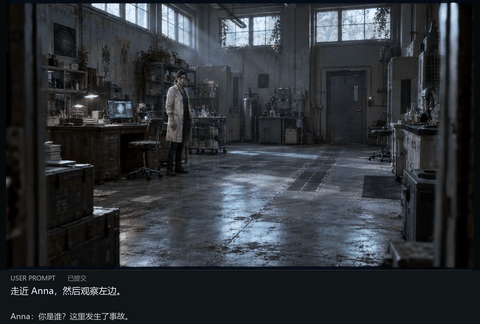

# InterActWorld Game

**A text-driven narrative agent connected to an action-conditioned video generator.**

This `game` branch contains the interaction layer: structured planning, rule-checked actions, story state, memory, bounded goal execution, visual feedback and a local web interface. The [`video` branch](https://github.com/HuanYn/InteractWorld/tree/video) focuses on video-model training and inference. Shared Wan/video components remain in this repository.

The project is a research prototype, not a finished game or a real-time world simulator. A completed rule transition does **not** establish that the corresponding action appeared in the video.

## Recorded game demo

[](assets/demos/game-agent-demo.mp4)

[Full video (MP4, 54.6 s)](assets/demos/game-agent-demo.mp4) · [Media provenance](assets/demos/game-agent-demo.json)

Recorded B/key-route functional run: nine actual model clips with logged inputs and authored NPC dialogue, including an explicit interior scene cut. This edited presentation of asynchronous outputs is not a raw screen recording; live streaming and visual success are unverified. The GIF previews the opening 12 seconds.

## What is implemented

- One laboratory narrative with three configured routes: trust Anna, investigate independently/find the key, or investigate the terminal and Leo.
- Two NPCs, Anna and Leo, with state-dependent dialogue and relationship updates. Dialogue is authored from game state; it is not a separately trained NPC simulator.
- Free-text single-turn planning and bounded multi-step goals. The agent proposes tools; the rule engine owns inventory, prerequisites and story transitions.
- Short-term interaction history and persistent event memory within a session.
- Goal changes during generation take effect at a safe step boundary. Operation IDs prevent duplicate commits, and automatic replanning is capped at two attempts.
- Separate execution, rule and visual-feedback records; session JSON export and saved-session inspection.
- Mock rendering, an OpenAI-compatible language-model adapter and a real Wan laboratory renderer. Pre-generated cinematic playback, when configured separately, is explicitly identified as playback.

```text
Player text + current observation + state + memory
    → structured proposal → rule checks → action / camera controls
    → renderer → visual observation → restricted reconciliation → saved session
```

Visual observations are fallible evidence. They cannot directly add a key, unlock a door, change trust or advance the story.

## Current evidence and limitations

The integrated video path uses Wan2.2-TI2V-5B with the project's R005 action adapter/LoRA, historically evaluated at step 1040. It is not seven independent camera-LoRA checkpoints, and this branch does not contain the weights. With the opt-in story-lineage mode, later clips are conditioned on the same session's actual generated endpoint, rather than silently resetting to the opening image. An authored interior scene cut is a declared cut, not proof of walking through the same door.

An actual key-route run reached its **rule** ending, retaining interruption, failure/recovery and exported history. Its generated clips still exhibit identity and geometry drift, unreliable object interactions and unverified same-door navigation. The three routes and both NPCs are implemented in software, but this run did not visually validate all three routes. It is asynchronous generation, not measured real-time gameplay.

The historical deployment's finite model-service windows have ended. Its archived video/download interface is not a currently running free-generation service. This release provides portable source and an offline starting point; it does not restart that deployment or distribute its private launch grants.

The dedicated `door_unlock` prompt mapping is included as a software correction. It requires an explicitly encoded matching cache entry and refuses a missing key instead of falling back to a generic scene. This does **not** establish visually correct unlocking.

## Quick start: no model required

Python 3.10 or newer is required by the source syntax. The UI uses Gradio 5.x. Run commands from the repository root, in a fresh environment:

```bash
git clone --branch game https://github.com/HuanYn/InteractWorld.git
cd InteractWorld
python -m venv .venv
source .venv/bin/activate
python -m pip install -r requirements-agent.txt
python scripts/serve_agent.py --mode mock --port 8873 --output-root outputs/sessions
```

On Windows, activate with `.venv\Scripts\Activate.ps1`. Open **http://127.0.0.1:8873**. The server binds to loopback and does not create a public sharing link.

Mock mode uses an offline parser and procedural illustrations: **neither an LLM nor Wan generation**. Start a demo and submit one instruction at a time. The shipped story and dialogue are primarily Chinese; these original examples avoid implying that arbitrary English requests are supported by the offline parser:

| Route | Example sequence |
| --- | --- |
| Anna | `走近 Anna` → `帮助 Anna` → `询问密码` → `检查终端` → `进入核心区域` |
| Key | `走近 Anna` → `我不相信 Anna` → `搜索桌子` → `拿起钥匙` → `打开门` → `进入储藏室` |
| Terminal | `检查终端` → `读取终端日志` → `找到 Leo` → `询问 Leo` |

Try opening the locked door without a key. The rule engine should reject the transition. Inspect history/state and export the session; do not interpret the mock animation as a learned physical action.

## Connect a language model

Use a separately managed OpenAI-compatible endpoint. `/v1/chat/completions` is required; the UI checks `/v1/models` or the local provider's `/health`. Keep credentials in environment variables, never in tracked files.

```bash
export IW_LLM_BASE_URL=http://127.0.0.1:8874/v1
export IW_LLM_MODEL=base-general
python scripts/serve_agent.py --mode llm --port 8873 --output-root outputs/sessions
```

This mode uses an actual configured LLM with **Mock visuals**. `IW_GOAL_MODEL` can select a separate goal-planning model. A planner adapter is optional, not universally better than Base; retain the model/adapter identity when comparing results.

For an already downloaded local Qwen3-VL model, `scripts/serve_planner.py` provides the endpoint:

```bash
python scripts/serve_planner.py --model /path/to/local/Qwen3-VL-4B-Instruct \
  --device cpu --threads 2 --port 8874
```

This optional provider additionally needs PyTorch, Transformers with Qwen3-VL support and Accelerate; loading an adapter also needs PEFT. They are not required for Mock mode. Models are loaded from local files; no model download is performed by this command. CPU model loading is substantial and may be slow. CUDA execution requires the operator's own exclusive allocation, explicit device selection and finite supervision; a UI button does not allocate a GPU.

## Real video integration

`interactive/lab_video.py` connects the existing action-conditioned sampler to laboratory text embeddings and RGB inputs. `scripts/serve_lab_video.py` is a loopback service adapter, not a cluster scheduler. Real inference additionally needs the video dependencies in `requirements-gpu.txt`, the matching model assets, a compatible GPU and independently managed resource allocation.

Required assets are **not bundled**:

1. Legally obtained Wan base/VAE weights and the matching self-trained action adapter/LoRA.
2. The original checkpoint's training configuration and its manifest/feature/prompt receipts. The lineage loader verifies these; do not rewrite them to fabricate compatibility.
3. The action rollout configuration and its original asset-root identity, plus an exact laboratory prompt embedding cache including negative conditioning and every requested action key.
4. An initial RGB image and a dedicated writable runtime directory. The UI and video service must see the same filesystem paths, or an operator must provide a proper transport adapter.

Set `IW_ACTION_ROLLOUT` to your rollout configuration and `IW_ASSET_ORIGINAL_ROOT` to the actual original root recorded in its receipts. Supply runtime paths via CLI; private machine locations are not published. The loader still checks checkpoint/configuration/conditioning provenance.

After preparing compatible assets, an operator can run the bounded service **inside their own exclusive GPU allocation**:

```bash
export CUDA_VISIBLE_DEVICES=0  # only a device allocated to you
export IW_ACTION_ROLLOUT=/path/to/assets/rollout.yaml
export IW_ASSET_ORIGINAL_ROOT=/actual/original/root/from/receipts
python scripts/serve_lab_video.py --snapshot /path/to/assets \
  --prompt-cache /path/to/laboratory-prompts.pt --runtime-root /path/to/runtime \
  --max-seconds 2400 --idle-seconds 180 --port 8878 --launch
```

The whole-process bound includes loading; it does not acquire locks or authorize use of someone else's GPU. Missing assets are a hard error. The public port adapter has not been GPU-qualified as a clean-install reproduction.

With the LLM and video services already running:

```bash
export IW_WAN_BASE_URL=http://127.0.0.1:8878
export IW_LAB_INITIAL_IMAGE=/path/to/runtime/initial.png
python scripts/serve_agent.py --mode wan --port 8873 \
  --output-root /path/to/runtime/sessions --visual-observer
```

This default laboratory entry is experimental, not the historical finite full-story deployment. Strict current-frame/story-lineage and advisory modes are separate opt-ins in the source. Advisory warnings must remain recorded; they do not become visual approval. Cinematic playback needs its own explicitly sourced manifest and is not a substitute for this live path.

For an intentionally read-only local archive, set `IW_CLOSED_DEMO_HANDOFF=read_only`. Explicit authored room cuts additionally require the operator's manifest and its actual `IW_ROOM_MANIFEST_SHA256`; no historical private scene asset is bundled.

## Tests and planner data

Run the small, asset-free core suite:

```bash
python -m pytest -q tests/test_agent_core.py
```

Additional task, feedback and interruption tests use fixtures or fake providers. Their passing results do not constitute an LLM or GPU/visual benchmark.

The source includes curated seed definitions, optional bounded paraphrase generation and planner LoRA training/evaluation code:

```bash
python scripts/generate_sft_dataset.py --provider seeds --output outputs/seed-data
python training/agent_sft/train.py --help
python training/agent_sft/evaluate.py --help
```

Seed export does not call a model. Provider-driven expansion requires explicit endpoint configuration; inspect its content and keep development/evaluation families separate. Planner SFT is not video-generator training. No trained planner, private dataset or original session transcript is distributed here.

## Layout

```text
interactive/            # agent, rules, state, memory, tasks, renderers and UI
configs/story*.yaml     # configured narrative routes
configs/characters.yaml
scripts/serve_agent.py  # mock / LLM / Wan UI
scripts/serve_planner.py
scripts/serve_lab_video.py
training/agent_sft/     # planner training and evaluation
training/demo/         # shared action-conditioned video foundation
tests/                 # software contracts; not visual acceptance
```

Private cluster launchers, grants/ledgers, fixed-session recovery tools, credentials, caches, raw sessions and model weights are excluded. Runtime outputs belong in ignored directories. The code and retained third-party components follow [LICENSE](LICENSE), [NOTICE](NOTICE) and [THIRD_PARTY_NOTICES.md](THIRD_PARTY_NOTICES.md); those notices do not grant rights to separately acquired model or game assets.
