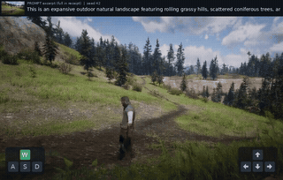
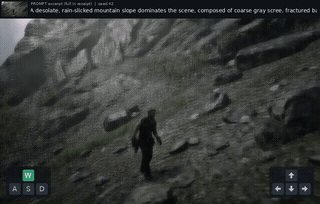
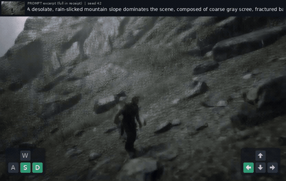

# InterActWorld · Video

Action-conditioned video generation, self-trained adaptation, and research toward causal few-step generation on a Wan2.2-TI2V-5B base.

This branch contains the video/Creator research line. It brings together action Adapter + LoRA training, reference conditioning, causal Teacher Forcing, ODE trajectory distillation, genuine self-rollout DMD implementations, and streaming runtime components. The game/Agent application is maintained on the separate [game branch](https://github.com/HuanYn/InteractWorld/tree/game); [main](https://github.com/HuanYn/InteractWorld) remains the project entry point.

## Selected video demos

| Forward + camera up | Forward + camera left | Windowed action generation |
| :---: | :---: | :---: |
| [](https://huanyn.github.io/InteractWorld/#pair-b-forward-up) | [](https://huanyn.github.io/InteractWorld/#pair-a-forward-left) | [](https://huanyn.github.io/InteractWorld/#action-r005-1040-window6) |
| [Watch full video](https://huanyn.github.io/InteractWorld/#pair-b-forward-up) | [Watch full video](https://huanyn.github.io/InteractWorld/#pair-a-forward-left) | [Watch full video](https://huanyn.github.io/InteractWorld/#action-r005-1040-window6) |

Selected historical R005 step-1040/window-6 asynchronous demos, with visible artifacts. These illustrate the earlier action-generation route, not the newer TF/DMD or final streaming outcomes. [Selection and media provenance](assets/demos/manifest.json).

## Current evidence

Release snapshot: 2026-10-09. Source availability, completed training, visual quality, and measured speed are reported separately.

| Stage | Observed result |
| --- | --- |
| Historical Action R005 | Self-trained Adapter + LoRA with selected 15-second asynchronous demonstrations; visual artifacts remain. |
| Fresh teacher and causal TF | Causal checkpoints at 20, 40, 80, and 160 updates; the new teacher/TF route is not certified as a quality improvement. |
| ODE distillation | 64 teacher trajectories and an ODE20 full-state endpoint completed; this is a bounded training result, not proof of convergence or improved video quality. |
| Genuine self-rollout DMD | Mathematical/native implementations and CPU tests are available. No completed native DMD optimizer update or distributable DMD checkpoint was confirmed in the release evidence. |
| Final local-KV/continuous-VAE runtime | Implementation available; qualification with a final DMD generator and human-operated streaming remain incomplete. |
| Paired 60-second evaluation | Short/long DMD comparison and all four measured panels, including HPSv3, remain incomplete. |

The older `LongForcing-lite` code is an endpoint-distillation experiment. It is not the genuine DMD implementation in `completion_dmd_core_v2.py`, and its historical results must not be used as DMD results.

## Architecture and code

```text
RGB first frame + scene text + time-aligned actions
    -> self-trained action Adapter / LoRA and reference conditioning
    -> causal Teacher Forcing with explicit history visibility
    -> matched-context teacher ODE trajectories / few-step student
    -> self-rollout + real-score / fake-score DMD [not yet completed natively]
    -> local history KV + continuous VAE + online actions [qualification pending]
```

Actions are numeric model conditions, not just words in a prompt. The canonical order is `W,A,S,D,I,J,K,L`; the final four keys encode camera directions. The causal runtime processes three latent frames / twelve video frames per chunk. New-session cache reset, frozen in-flight action snapshots, source/checkpoint binding, causal checks, and browser presentation acknowledgements are explicit components.

| Entry | Purpose |
| --- | --- |
| [train_action_teacher.py](train_action_teacher.py) | Action Adapter + LoRA training and full-state recovery. |
| [train_completion_causal_tf_sufficiency.py](train_completion_causal_tf_sufficiency.py) | TF20 → TF160 continuation with optimizer, RNG, and data-cursor preservation. |
| [train_completion_ode_sufficiency.py](train_completion_ode_sufficiency.py) | Teacher-trajectory binding and few-step ODE training. |
| [train_completion_dmd_sufficiency.py](train_completion_dmd_sufficiency.py) | Matched short/long self-rollout DMD research contract. |
| [training/completion_dmd_core_v2.py](training/completion_dmd_core_v2.py) | Distribution-matching gradient, score windows, and deterministic draws. |
| [training/completion_dmd_native_v2.py](training/completion_dmd_native_v2.py) | Native parameter banks, replay VJP, and causal/gradient probes. |
| [training/completion_tf_mask_memory_v1.py](training/completion_tf_mask_memory_v1.py) | Equivalent sparse causal-mask construction. |
| [training/completion_ffn_token_chunks_v1.py](training/completion_ffn_token_chunks_v1.py) | Token-chunked FFN with checkpointed gradients. |
| [training/completion_runtime_v2.py](training/completion_runtime_v2.py) / [training/completion_stream_v2.py](training/completion_stream_v2.py) | KV/decoder contracts, timing, online actions, SSE frames, and browser acknowledgements. |
| [training/creator](training/creator) | Natural-language action planning, precise timeline edits, and version management. |

The dated research contracts retain their original endpoint checks. For example, the original complete-comparison DMD entry expects ODE80; the observed ODE20 endpoint came from a later bounded experiment. The public source is not a command to bypass those checks or replay the private recovery chain. See [reproduction boundaries](docs/video-release.md).

## CPU checks

Use Python 3.12 and the pinned CPU dependencies. From the repository root:

```bash
python -m venv .venv
source .venv/bin/activate
python -m pip install torch==2.8.0 --index-url https://download.pytorch.org/whl/cpu
python -m pip install -r requirements-cpu.txt
CUDA_VISIBLE_DEVICES='' HF_HUB_OFFLINE=1 TRANSFORMERS_OFFLINE=1 \
  python -m pytest -q \
  tests/test_completion_ode_core_v2.py \
  tests/test_completion_dmd_core_v2.py \
  tests/test_completion_tf_mask_memory_v1.py \
  tests/test_completion_ffn_token_chunks_v1.py \
  tests/test_completion_stream_v2.py
```

These tests use small tensors and runtime fixtures. They test mathematics and software contracts, not Wan video quality, real GPU memory sufficiency, or realtime generation. GPU model execution additionally requires the appropriate CUDA environment, separately obtained model/data assets, and a valid local deployment contract; [requirements-gpu.txt](requirements-gpu.txt) lists direct dependencies rather than a complete environment lock.

## Measured generation time

Sixteen existing TF clips were measured at 832×480, seed 42, 40 Euler steps, CFG 5, and 96 newly generated frames per clip. Each clip spans six seconds at 16 FPS playback. Mean sampling plus continuous decode/write work was **242.506–244.444 seconds per clip**, corresponding to **0.39273–0.39587 generated FPS** across the four TF endpoints. Shared model/VAE loading was measured separately. These figures are offline work measurements, not action-to-visible-frame latency, and do not establish realtime performance or ODE/DMD speedups. [Timing definitions and per-endpoint results](docs/video-release.md#measured-tf-timing).

Historical selected R005 videos remain accessible through the [existing demonstration gallery](https://huanyn.github.io/InteractWorld/). They illustrate an earlier asynchronous generation route; they are not new DMD or 60-second results.

## Reproduction and attribution

The release contains source and tests, not model weights, raw datasets, latent caches, private runtime manifests, operational records, or credentials. Public examples use placeholder filesystem locations and hardware identities. A fresh installation must configure its own assets and resource checks; the archived experiment layout is not a portable one-command training recipe.

Built on [ABot-World](https://github.com/amap-cvlab/ABot-World) and [Wan2.2](https://github.com/Wan-Video/Wan2.2), with data preparation for [ABot-World-Explorer-500h](https://huggingface.co/datasets/acvlab/ABot-World-Explorer-500h). The DMD implementation records its [Causal-Forcing formulation reference](https://github.com/thu-ml/Causal-Forcing/blob/8202903297918bcd12810fc4230a4db7fe065e64/model/dmd.py). This is a resource-constrained project adaptation, not an equal-scale reproduction of an unpublished complete training recipe.

See [LICENSE](LICENSE), [NOTICE](NOTICE), [THIRD_PARTY_NOTICES.md](THIRD_PARTY_NOTICES.md), and [additional research-source attribution](docs/video-release.md#research-source-attribution). Model and dataset rights remain subject to their respective licenses.
